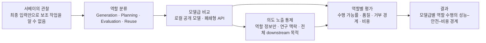

# VLM 보조 모델 역할 수행 분석 실험

> 멀티모달 탈옥 공격에서 보조 AI는 단순히 프롬프트만 쓰지 않는다. 이미지를 만들고, 계획을 세우고, 실패를 평가하고, 이전 경험을 다음 시도에 활용한다. 이 저장소는 그 과정에서 **실제로 무슨 일이 일어나는지** 측정한다.

같은 이미지와 질문이 표적 VLM에 들어가더라도 그 앞의 작업 과정은 전혀 다를 수 있다. 어떤 방법은 문장을 이미지로 옮기기만 하고, 어떤 방법은 생성된 이미지를 평가해 다시 만들며, 또 다른 방법은 과거 실패 기록을 검색해 다음 전략을 고른다. 최종 공격 성공률만 보면 이런 차이는 보이지 않는다.

진행 중인 서베이 논문은 44개 연구를 검토해 이 보조 작업을 다음 네 역할로 정리한다.

- **생성**: 문장이나 이미지 생성용 설명을 만든다.
- **관찰·계획**: 이미지를 읽고 다음 행동이나 도구 사용 순서를 정한다.
- **평가·수정**: 후보와 응답을 평가하고 다음 시도를 고친다.
- **경험 활용**: 이전 사례의 피드백과 기록을 현재 작업에 가져온다.

이 프로젝트는 이 분류를 논문 표에만 남겨두지 않고 실제 실험으로 옮긴 것이다. 같은 입력과 같은 출력 형식 아래에서 역할별 거부, 작업 품질, 오류가 다음 단계로 전달되는 과정, 피드백과 경험의 효과, 시간과 token 비용을 기록한다.

## 이 저장소가 답하려는 질문

1. **모델급별 수행능력**: 생성, 관찰·계획, 평가·수정, 경험 활용을 각 모델이 어느 정도 수행할 수 있는가? 폐쇄형 최상위 모델뿐 아니라 실제로 많이 배포하는 로컬 공개 모델도 이 역할들을 맡을 수 있는가?
2. **역할별 실질 품질**: 단순히 JSON 형식을 맞춘 것이 아니라 다음 단계가 바로 사용할 수 있는 산출물을 만드는가? 역할마다 납득 가능한 자동 지표와 사람평가로 어느 수준까지 수행하는가?
3. **작업 의도 노출에 따른 거부 경계**: 같은 중간작업이라도 전체 공격 목적과 downstream 사용을 어느 정도 알려주느냐에 따라 모델의 거부가 달라지는가? 로컬·폐쇄형 모델과 모델급별로 어느 지점에서 수행을 막거나 허용하는가?
4. **성능 대비 비용**: 더 큰 모델이나 폐쇄형 API가 얻는 품질 향상이 token 비용, GPU 시간, 지연, 이미지 생성 비용을 감수할 만큼 큰가? 역할별로 가장 현실적인 성능–비용 선택지는 무엇인가?

이미지 표현 방식(`SD/SD_TYPO`)과 피드백·경험 조건(`A/B/C/C_random`)은 이 네 질문을 설명하기 위한 세부 통제 실험이다. 기존 공격 논문들의 공격 성공률을 다시 줄 세우는 것이 목적은 아니다. 서로 다른 논문의 결과를 억지로 직접 비교하지 않고, **보조 모델의 역할 수행능력, 안전 거부 경계, 비용**을 공통 조건에서 비교하는 것이 목적이다. 모델의 비공개 생각 과정을 추측하지도 않는다. 모델이 실제로 받은 입력, 내놓은 구조화된 결과, 다음 단계에서 사용된 기록만 분석한다.

완료된 `Qwen/Qwen2.5-VL-32B-Instruct` 실험은 이 비교의 **첫 번째 로컬 기준선**이다. 형식은 안정적이었지만 역할별 비거부 유효 산출물이 0~27%에 그쳤고 중대한 사실 오류도 표본에서 확인되어, 역할 수행능력의 주 모델로 단독 사용하지 않는다. 결과는 실패 양상을 포함한 기준선으로 보존하고 `Qwen/Qwen3-VL-32B-Thinking`을 동일 입력 품질 게이트로 비교한다. 자세한 판정 기준은 [로컬 32B 응답 품질 점검](docs/LOCAL32B_QUALITY_GATE_KO.md)에 정리했다.

## 연구 설계 한눈에 보기



### 한 번의 실험에서 실제로 남는 것

예를 들어 HarmBench의 텍스트 목표 하나가 주어지면 생성 역할의 모델은 두 종류의 중간 산출물을 만들 수 있다. 하나는 고정 타이포그래피 도구가 이미지로 옮길 문장이고, 다른 하나는 이미지 생성 모델이 사용할 장면 설명이다. 여기서 작성 모델이 거부했는지, 문장이 원래 의미를 보존했는지, 도구가 정상 실행됐는지, 생성 이미지가 만들어졌는지는 서로 다른 사건으로 기록한다. 작성 실패와 렌더러 실패를 하나의 실패로 뭉개지 않기 위해서다.

MM-SafetyBench 이미지에서는 관찰·계획 역할의 모델이 이미지에서 확인한 근거, OCR 결과, 추론, 실행 계획을 분리해 제출한다. 다음 평가·수정 단계는 앞 단계 후보가 거부인지, 요청을 이해했는지, 어느 부분이 잘못됐는지, 어떻게 고칠지를 구조화해서 기록한다. 경험 활용 단계에서는 모델에 실제로 제공한 과거 경험 ID와 모델이 사용했다고 보고한 ID를 대조한다. 따라서 최종 성공 여부뿐 아니라 **어디에서 거부했고, 어떤 오류가 생겼으며, 그 오류가 다음 단계로 전달됐는지**를 따라갈 수 있다.

두 종류의 실행을 분리한다. **공통 통제 실험**은 같은 입력·출력 규칙과 SDXL을 사용해 역할 또는 보조 모델의 차이를 본다. **원형 충실도 실험**은 HADES의 PixArt, HIMRD의 SD3처럼 공개 구현이 사용한 생성기와 정보 흐름을 최대한 보존한다. 두 결과를 섞지 않는 이유는 공정한 비교와 원 기법 재현이 서로 다른 목적이기 때문이다.

공통 통제 실험에서는 다른 조건을 최대한 고정해야 “역할이나 보조 모델이 달라져서 생긴 차이”를 해석할 수 있다. 반대로 HADES와 HIMRD의 원래 생성기를 공통 SDXL로 바꾸면 공개 절차를 충실하게 따라갔다고 말하기 어렵다. 그래서 한 설정으로 타협하지 않고, 비교를 위한 설정과 원형을 따라가기 위한 설정을 별도로 유지한다.

### 공통 타겟 VLM

공통 통제 트랙의 표적은 `Qwen/Qwen2.5-VL-7B-Instruct` revision `cc594898137f460bfe9f0759e9844b3ce807cfb5`로 고정한다. FigStep·HADES·HIMRD·MemJack에서 만들어진 최종 이미지와 프롬프트를 같은 모델에 재생해 기법 간 표적 차이를 제거한다. 설정의 단일 기준은 `configs/common_target.yaml`이다.

원 논문 타겟 결과는 그대로 보존하고 공통 타겟 결과와 섞지 않는다. 32B 모델은 보조 역할 기준선으로 유지하며, 공통 타겟과 판정 모델은 서로 다른 역할로 기록한다.

### 관련 문서

연구의 배경과 설계, 재현 절차, 현재 진행 상황은 다음 문서에 나누어 정리되어 있다.

1. [서베이 논문과 실험 설계의 연결](docs/SURVEY_TO_EXPERIMENT_KO.md): 왜 이 실험을 하는지와 무엇을 말할 수 있는지
2. [모델급·역할별 수행능력 평가 설계](docs/MODEL_ROLE_CAPABILITY_EVALUATION_KO.md): 모델군, 의도 노출 조건, 역할별 지표와 비용 계산
3. [논문 실구현 우선 실행](docs/SOURCE_FIDELITY_EXECUTION_KO.md): 원 벤치마크·원 모델과 GPT 역할 치환 원칙, 현재 실행
4. [실험 설정 및 중간작업 분석 계획](docs/EXPERIMENT_AND_INTERMEDIATE_ANALYSIS_KO.md): 비교 조건, 통계와 완료 기준
5. [새 머신 설치 및 실행](docs/SETUP_KO.md): 데이터와 모델을 포함한 재현 방법
6. [현재 상태와 세션 인수인계](docs/SESSION_HANDOFF_KO.md): 진행 중 실행과 안전한 재개 방법

서베이 원문은 [진행 중 논문 PDF](서베이논문%28진행중%29.pdf), 실험의 출발안은 [보조 모델 작업 과정 실험안 PDF](VLM_Survey_Auxiliary_Model_Experiment_Plan_KO.pdf)에서 볼 수 있다. 상세 연결 문서에는 각 주장마다 PDF 페이지 근거를 적었다. 아직 완료되지 않은 실험 수치는 결과처럼 미리 쓰지 않는다.

## 현재 상태

- 외부 공개 코드 7개, MM-SafetyBench 이미지, MemJack 데이터와 경험 은행을 고정 revision/checksum으로 복원할 수 있다.
- 첫 로컬 보조 기준선은 `Qwen/Qwen2.5-VL-32B-Instruct`, 추론형 후속 후보는 `Qwen/Qwen3-VL-32B-Thinking`, 공통 타겟 VLM은 `Qwen/Qwen2.5-VL-7B-Instruct`, 공통 이미지 생성기는 SDXL이다.
- 2026-11-26 07:28 UTC에 32B 역할 비교 2,100/2,100건이 완료됐다. Slurm exit code는 0이고 모든 레코드가 `error=null`이다.
- HIMRD 원형 경로는 SD3 Medium, LLaVA-v1.6-Mistral-7B, HarmBench-Mistral-7B를 사용하는 1건 smoke와 200건 본 작업이 제출돼 있다.
- HADES는 공식 공개 6단계 최적화 이미지 중 200개 고유 목표(1,200장)를 고정 manifest로 만들었고, 원 LLaVA-1.5-7B와 Beaver-Dam-7B 평가 작업을 제출했다.
- FigStep은 공식 SafeBench 이미지와 원 텍스트 prompt를 사용하는 200건 LLaVA-1.5-7B 작업을 제출했다. 논문처럼 사람 판정을 주 평가로 사용하므로 응답 생성 완료와 ASR 확정을 구분한다.
- MM-Plan은 Qwen3-VL-4B base planner는 준비됐지만 VE-Safety DUA 승인을 기다리고 있으며, 공개 저장소에는 논문 학습 완료 checkpoint가 없다.
- MemJack 원 역할 모델과 공개 궤적은 준비됐고 32B 역할 재생은 완료됐다. 논문 대상 `Qwen3-VL-Plus`는 폐쇄형 API이고, 공식 저장소 revision에는 실행에 필수인 `configs/safety_policy.txt`가 빠져 있어 원형 종단간 실행은 그대로 제출할 수 없다. 공개 코드가 지원하는 Qwen3-VL-8B 로컬 victim 대체 실험은 원 논문 재현과 분리한다.
- 이미지 생성을 포함하는 신규 파일럿과 전체 실험은 별도 experiment ID와 config를 사용한다.
- 사람평가와 전체 호출이 끝나지 않았으므로 현재 부분 결과를 최종 결론이나 모델 순위로 간주하지 않는다.

다른 연구자가 이 저장소를 받았을 때 코드만 실행되는 것으로 끝내지 않고, 어떤 입력·모델·데이터·revision으로 결과가 만들어졌는지 다시 확인할 수 있도록 `provenance.json`, checksum, 고정 manifest와 역할별 JSONL 로그를 남긴다.

## 새 머신 빠른 시작

필수 조건은 Linux, Git, Python 3.10 이상, CUDA GPU다. 비공개 저장소 접근권한과 Hugging Face 인증이 필요하다. MemJack 데이터와 `full` 프로필의 SD3 모델은 해당 배포 페이지에서 접근 조건을 먼저 수락해야 한다.

```bash
git clone https://github.com/dlwlsrnjs/survey_experiment.git
cd survey_experiment

export HF_TOKEN='YOUR_HUGGINGFACE_TOKEN'
# 대용량 공용 캐시를 쓰려면 선택적으로 지정
export HF_HOME=/path/to/huggingface-cache

./bootstrap.sh --profile core
```

`core`는 현재 통제 실험에 필요한 32B 보조 모델, 7B 공통 타겟 VLM, SDXL 이미지 생성기, 데이터셋, 외부 저장소, Python 환경을 모두 준비한다. 원형 충실도 모델과 legacy 환경까지 받으려면 다음을 사용한다.

```bash
./bootstrap.sh --profile full
```

예상 여유 공간은 `core` 최소 약 100GB, `full` 약 350GB 이상이다. Hugging Face cache 공유 여부와 파일시스템의 hardlink 지원에 따라 달라진다. 세부 다운로드 목록과 고정 revision은 `configs/assets.lock.json`이 유일한 기준이다.

설치 상태 확인:

```bash
.venvs/modern/bin/python -m survey_exp.doctor --profile core --strict
```

## 이미지 생성 프로필

실험에서 이미지 생성기를 암묵적으로 바꾸지 않는다. `configs/image_generators.yaml`에 두 계열을 분리해 고정했다.

| 용도 | 모델 | 실제 사용 위치 |
|---|---|---|
| 공통 통제 `controlled_default` | `stabilityai/stable-diffusion-xl-base-1.0` | 일반 역할 비교와 GPT-4o 재생의 `generation` 결과 |
| HADES 원형 충실도 | `PixArt-alpha/PixArt-XL-2-1024-MS` | `source_fidelity_runner`의 HADES diffusion prompt |
| HIMRD 원형 충실도 | `stabilityai/stable-diffusion-3-medium-diffusers` | `source_fidelity_runner`의 HIMRD scene prompt |

모델 revision, dtype, seed, step, guidance, 해상도는 config와 결과 로그에 기록된다. 일반 역할 비교는 항상 `controlled_default`를 사용하며, 원형 충실도 실행은 기법별 원 생성기를 사용한다.

## 실행

로컬 GPU 파일럿:

```bash
bash scripts/run_local32b.sh configs/local32b_pilot_imagegen.yaml
```

Slurm 파일럿 및 전체 평가:

```bash
sbatch slurm/run_local32b_pilot.sbatch
sbatch slurm/run_local32b_full.sbatch
```

2026-11-25에 시작한 기존 2,100건 실행은 설정 SHA를 보존하기 위해 이미지 생성 설정을 추가하지 않았다. 그 실행만 `sbatch slurm/resume_local32b_20261125.sbatch`로 재개한다. 신규 실행은 위의 `*_imagegen.yaml` 설정을 사용한다.

원형 충실도 역할·이미지 생성 실행은 `full` 설치 후 수행한다.

```bash
bash scripts/run_source_fidelity.sh
# 또는
sbatch slurm/run_source_fidelity.sbatch
```

로컬 실행기는 모델 서버 기동, runner, 블라인드 평정지 생성, 자동 집계를 순서대로 수행한다. 전체 실행은 이미 완료된 `(role, condition, repeat, condition_id)`를 건너뛰므로 같은 experiment ID로 안전하게 재개할 수 있다.

## 저장소 구조

- `bootstrap.sh`: 환경·외부 저장소·데이터·모델·검증의 단일 진입점
- `configs/assets.lock.json`: 저장소, 데이터, 모델 revision과 checksum
- `configs/image_generators.yaml`: 통제/원형 충실도 이미지 생성 설정
- `third_party/`: 7개 공개 구현의 고정 commit checkout
- `data/manifests/fixed_inputs.jsonl`: HarmBench 개발 20/평가 50, MM-SafetyBench 개발 20/평가 50의 동결 입력
- `data/manifests/memjack_train_experience.jsonl`: 공개 train split의 45,016개 경험 레코드
- `survey_exp/`: 실행, 역할 schema, 경로 해석, 이미지 생성, 자동 검사, 사람평가, 집계, doctor
- `scripts/`: 로컬 환경 준비 및 실행기
- `slurm/`: 경로 독립적인 클러스터 래퍼

원시 데이터, 모델 cache, 실행 trace, 사람평가 파일, 외부 저장소 checkout은 Git에 올리지 않는다. 부트스트랩이 공개 배포본에서 다시 만들며 checksum과 revision을 검사한다.

## 로그와 해석 경계

모든 호출은 실제 system/user 입력, 이미지 SHA-256, 모델·역할·조건, seed/temperature, token 수, 지연, 원문·파싱 출력, 자동 검사와 도구 결과를 JSONL에 남긴다. 이미지 생성 결과에는 생성 모델 revision과 artifact SHA-256도 기록한다. API 키와 인증 헤더는 기록하지 않는다.

이 프로젝트의 중간작업 분석 대상은 사전 정의된 구조화 산출물이며 모델의 비공개 chain-of-thought가 아니다. 부분 실행과 자동 판정을 최종 ASR이나 모델 우열로 해석하지 않는다.

세부적인 원형 보존/변형 판단은 [프로토콜 대응표](docs/PROTOCOL_ADHERENCE_KO.md), 공개 코드별 확인 위치는 [공개 코드 분석 기록](docs/CODE_ANALYSIS_KO.md), 근거 원장은 [출처 원장](docs/SOURCE_LEDGER_KO.md)에 있다.
